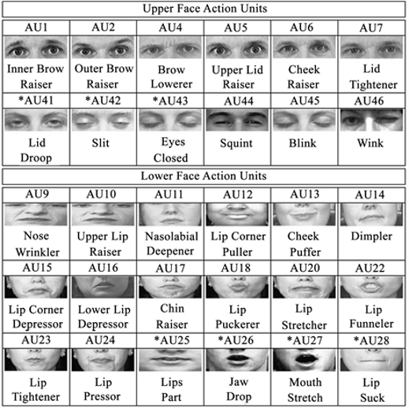
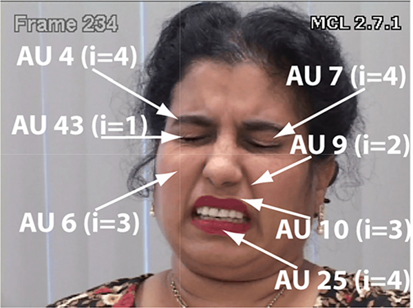

# Facial Pain Intensity Estimation: Edge AI Implementation on phyBOARD

Real-time facial pain detection running **fully on TensorFlow Lite**, built for embedded edge hardware (phyBOARD with NPU). The pipeline detects faces from a live webcam stream, classifies each face as *Pain* / *No Pain*, and overlays the result with a smoothed confidence score. No TensorFlow or Keras is needed at runtime.

---

## Table of Contents

- [Background](#background)
- [How It Works](#how-it-works)
- [Project Structure](#project-structure)
- [Requirements](#requirements)
- [Camera](#camera)
- [Usage](#usage)
- [Performance on phyBOARD](#performance-on-phyboard)
- [Configuration](#configuration)
- [Implementation Notes](#implementation-notes)
- [References](#references)

---

## Background

Pain is expressed through characteristic facial movements. These movements can be described objectively using the **Facial Action Coding System (FACS)**, which breaks facial expressions down into individual **Action Units (AUs)**, each tied to the contraction of specific facial muscles (e.g. AU4 = Brow Lowerer, AU6 = Cheek Raiser, AU43 = Eyes Closed).


*FACS upper-face and lower-face Action Units.*

The **Prkachin and Solomon Pain Intensity (PSPI)** metric turns the AUs most associated with pain into a single frame-level intensity score:

```
PSPI = AU4 + max(AU6, AU7) + max(AU9, AU10) + AU43
```

- AU4, AU6, AU7, AU9, AU10 are scored on a 0–5 intensity scale
- AU43 (eyes closed) is binary (0 or 1)
- PSPI therefore ranges from **0 (no pain)** to **16 (maximum pain)**

**Worked example** (annotated frame below): AU4 = 4, AU6 = 3, AU7 = 4, AU9 = 2, AU10 = 3, AU43 = 1

```
PSPI = 4 + max(3, 4) + max(2, 3) + 1 = 4 + 4 + 3 + 1 = 12
```


*Example frame annotated with AUs and their intensities (i) used to compute PSPI.*

This project brings pain-expression analysis to a low-power embedded device so it can run locally, in real time, without a cloud connection. That matters for privacy-sensitive settings such as patient monitoring.

---

## How It Works

```
Webcam frame (BGR)
   │
   ▼
SCRFD face detector (quantized TFLite)      ← tflite_common.detect_faces()
   │   letterbox → 640×640, decode per-stride anchors, NMS
   ▼
Crop each face (+20% margin) → resize 250×250
   │
   ▼
Pain classifier (full-integer quantized TFLite)
   │   int8 in / int8 out, output dequantized to pain probability
   ▼
Per-face tracking + EMA smoothing
   │
   ▼
Overlay: bounding box + "Pain (xx%)" / "No Pain (xx%)" + FPS
```

1. **Face detection**: a fully quantized SCRFD model. Since the model is fully quantized, pre/post-processing is done manually: uint8 input, per-tensor dequantization, anchor decoding for strides 8/16/32, and NMS.
2. **Pain classification**: each detected face is cropped with a margin, resized to 250×250, quantized to the model's int8 input, and run through the classifier. The output is dequantized into a pain probability.
3. **Temporal smoothing**: a lightweight centroid tracker assigns a stable identity to each face across frames and applies an exponential moving average (EMA) to the pain probability, which reduces flicker.
4. **Display**: green box for *No Pain*, red box for *Pain*, with the smoothed percentage and live FPS.

---

## Project Structure

```
.
├── main.py              # Live webcam pain-detection application
├── tflite_common.py     # Shared TFLite utilities: interpreter loading (CPU / NPU),
│                        #   SCRFD decoding, NMS, letterbox, ArcFace alignment/embedding
├── models/
│   ├── det_500g_640x640_full_quantized.tflite          # face detector (default)
│   └── pain_detection_full_integer_quant_v2.tflite     # pain classifier
├── docs/
│   ├── facs_action_units.png
│   └── pspi_example.png
└── README.md
```

> `tflite_common.py` also contains ArcFace alignment and embedding helpers (`norm_crop`, `get_embedding`). They are not used by the pain pipeline but are available for face-recognition extensions.

---

## Requirements

- Python 3.8+
- `numpy`
- `opencv-python`
- `tflite-runtime` (preferred on the board), or `tensorflow` as a fallback
- A USB webcam (tested with the **Dell WB3023 2K QHD Webcam**, see [Camera](#camera))
- *(Optional, on-board)* NPU VX delegate at `/usr/lib/libvx_delegate.so`

```bash
pip install numpy opencv-python tflite-runtime
```

---

## Camera

All testing and the benchmark numbers below were done with the **Dell WB3023 2K QHD Webcam**:

| Spec | Value |
|---|---|
| Video resolution | 1920 x 1080 |
| Digital zoom | 4X |
| Noise handling | 2D/3D noise reduction, noise-cancelling microphone |
| Interface | USB |
| Certification | Microsoft Teams / Zoom certified |

> **Use a high-resolution camera for facial applications.** Facial-analysis tasks such as pain detection depend on small, subtle muscle movements around the brows, eyes, nose and mouth (the AUs used by PSPI). A low-resolution or noisy camera blurs these details, especially when the person is farther from the lens or the face fills only a small part of the frame. A high-resolution camera with good low-light and noise handling, like the one used here, gives the detector and the classifier cleaner face crops and more reliable results.
>
> Higher resolution also costs more processing per frame on an embedded board (capture, color conversion and resizing), so the FPS you get will depend on the camera resolution you select.

---

## Usage

Run on CPU:

```bash
python main.py
```

Run with the NPU (VX delegate):

```bash
python main.py --npu
```

Run the pain classifier every 2nd frame to save compute:

```bash
python main.py --every 2
```

Press **`q`** to quit.

### Command-line arguments

| Argument | Default | Description |
|---|---|---|
| `--det-model` | `models/det_500g_640x640_full_quantized.tflite` | Path to the face detector model |
| `--pain-model` | `models/pain_detection_full_integer_quant_v2.tflite` | Path to the pain classifier model |
| `--camera` | `0` | Camera device index |
| `--npu` | off | Use the VX NPU delegate for both models (falls back to CPU if unavailable) |
| `--det-thresh` | `0.5` | Face detection score threshold |
| `--every` | `1` | Run the pain classifier every N frames |

---

## Performance on phyBOARD

Tested on the phyBOARD with the Dell WB3023 webcam (1920 x 1080) and the full pipeline (face detection + pain classification + tracking + display):

| Metric | Result |
|---|---|
| **Average FPS** | **~12 FPS** |
| **RAM usage** | **~32%** of the available **1.8 GB** |
| Approx. memory footprint | ~0.58 GB |

The pipeline fits comfortably in memory, leaving plenty of headroom for other applications on the board. Throughput can be raised further with `--npu` and `--every N`.

---

## Configuration

Tunable constants at the top of `main.py`:

| Constant | Default | Purpose |
|---|---|---|
| `PAIN_IMG_SIZE` | `250` | Classifier input resolution |
| `FACE_MARGIN` | `0.20` | Extra margin around the detected face box |
| `EMA_ALPHA` | `0.4` | Smoothing factor (higher = more responsive, lower = smoother) |
| `PAIN_THRESHOLD` | `0.5` | Probability above which a face is labeled *Pain* |
| `MAX_MISSED` | `10` | Frames a track survives without a matching detection |

---

## Implementation Notes

- **Fully quantized inference**: the detector takes uint8 input and the classifier takes int8 input (`scale = 1.0`, `zero_point = -128`). Every output tensor is dequantized with its own scale and zero-point.
- **Classifier input**: raw 0–255 BGR pixels, matching how the original Keras model was trained.
- **Anchor caching**: SCRFD anchor centers are computed once per stride and reused every frame.
- **Graceful NPU fallback**: if the VX delegate cannot be loaded (for example on a PC), the interpreter falls back to CPU automatically with multi-threading.
- **Multi-face support**: every detected face is classified and tracked independently.

---

## References

1. **Facial Action Coding System (FACS)**, Paul Ekman Group: https://www.paulekman.com/facial-action-coding-system/
2. **Prkachin and Solomon Pain Intensity Metric (PSPI)**: https://pmc.ncbi.nlm.nih.gov/articles/PMC7385931/

---

## Disclaimer

This project is a research and educational prototype. It is **not a medical device** and must not be used as the sole basis for clinical decisions.
